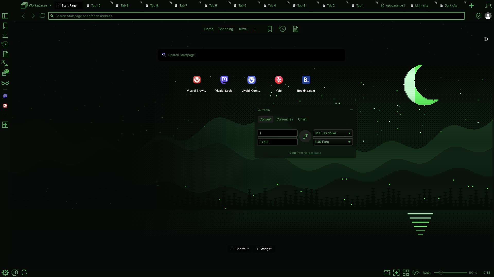
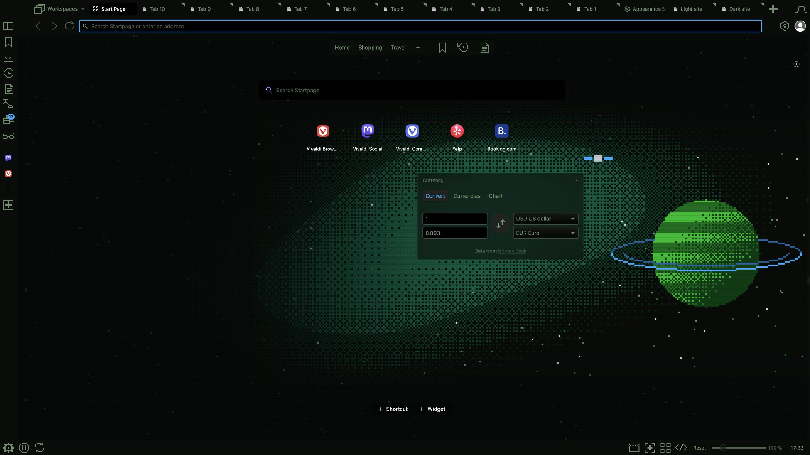

# VivaldiDark

Premium dark themes for the Vivaldi browser. Each theme pairs an original 4K background with colours tuned so tab
titles, the address bar, menus and Settings stay readable over the art. Background tabs stay softly dimmed and the
focused tab stays bright.

| | | |
|:-:|:-:|:-:|
| <br>**Shibuya Nocturne** | <br>**Neon Fuji** | <br>**Silk Nocturne** |
| <br>**Paris Nocturne** | <br>**Terminal City** | <br>**Pixel Valley** |
| <br>**8-Bit Cosmos** | | |

## Install

1. Download a theme's zip from its folder, e.g. [`themes/neon-fuji/Neon-Fuji.zip`](themes/neon-fuji/Neon-Fuji.zip).
2. In Vivaldi open **Settings → Themes**, choose **Import** (under the theme library) and pick the zip.

If Vivaldi keeps switching back to another theme, check **Settings → Themes → Schedule**: a schedule decides which
theme shows and overrides the one you picked.

## Icons

Every theme replaces all 79 toolbar buttons with its own icon family, drawn in `currentColor` so they follow the
theme's text colour:

- **Outline** ([`icons/`](icons)): thin line icons, used by Shibuya Nocturne, Neon Fuji, Silk Nocturne and Paris Nocturne.
- **Pixel** ([`icons/pixel/`](icons/pixel)): 14×14 pixel icons, used by Terminal City, Pixel Valley and 8-Bit Cosmos.

## Building from source

The art and the theme files are generated by code, so every zip can be rebuilt:

```sh
uv sync                                    # Python ≥ 3.12
uv run python -m tools.verify themes/neon-fuji   # build the zip, then check it live in Vivaldi
uv run pytest -m "not vivaldi"             # tests that don't launch Vivaldi
```

Each theme folder holds `scene.py` (the artwork), `theme.json` (its colours) and the built `background.webp` and zip.

Tested on macOS with Vivaldi 8.2; Windows and Linux untested.

## Credits

- Shibuya Nocturne, Neon Fuji and Silk Nocturne use colours inspired by [Tokyo Night](https://github.com/enkia/tokyo-night-vscode-theme) by Enkia (MIT).
- The palettes of Terminal City, Pixel Valley and 8-Bit Cosmos come from [canartuc.com](https://canartuc.com).
- All artwork and icons are original.

## License

[MIT](LICENSE)
