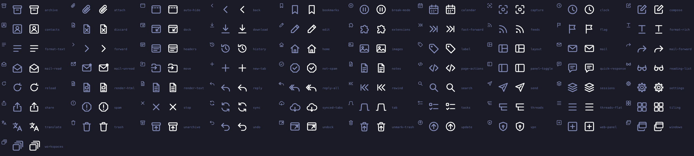
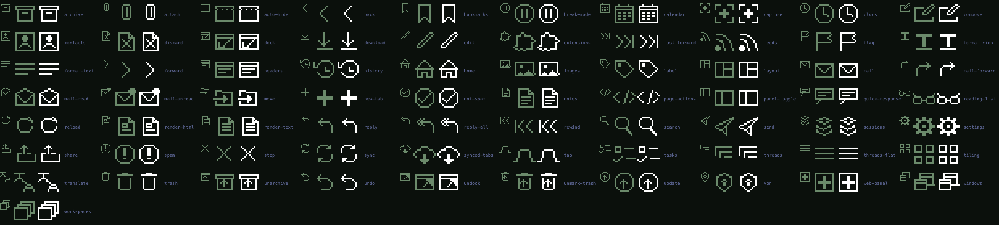

<h1 align="center">VivaldiDark</h1>

<p align="center">
  <b>Seven premium dark themes for the Vivaldi browser.</b><br>
  Original 4K art that flows behind the tab bar, address bar, panel and status bar,<br>
  with colours tuned so every label, menu and setting stays readable over it.
</p>

<p align="center">
  <a href="#install">Install</a> ·
  <a href="#the-themes">The themes</a> ·
  <a href="#icons">Icons</a> ·
  <a href="#building-from-source">Build</a> ·
  <a href="#credits">Credits</a>
</p>

<p align="center">
  
  
</p>

## What you get

- **Art that lives under the browser.** The background runs edge to edge and sinks into shadow under the bars, so
  tab titles never fight the picture.
- **You always know where you are.** Background tabs stay softly dimmed, and the focused tab stays bright.
- **Checked, not eyeballed.** Every theme is tested live in Vivaldi in 110 window states: 5 window sizes from
  1280×800 to 3440×1440, tabs on top and on the left. The tests also cover every Settings control, Vivaldi's popup
  menus and the native macOS menus, and readable contrast is required everywhere.
- **A matching icon set.** All 79 toolbar buttons are replaced: thin outline icons for the painted themes and crisp
  pixel icons for the pixel-art ones.

## Install

1. Pick a theme below and click **Download**.
2. In Vivaldi open **Settings → Themes**, choose **Import** and pick the zip.

If Vivaldi keeps switching back to another theme, check **Settings → Themes → Schedule**: an active schedule
decides which theme shows.

## The themes

### Shibuya Nocturne


A rainy night in a neon city canyon. Glowing signs climb the towers along both edges, a giant screen tower lights
up the right side and the wet street mirrors the lights.

**Palette** Tokyo Night · **Accent** `#7aa2f7` · **Icons** outline · **Corners** 8 px ·
[**Download**](https://github.com/canartuc/VivaldiDark/raw/main/themes/shibuya-nocturne/Shibuya-Nocturne.zip)

### Neon Fuji


Mount Fuji under a sliced synthwave moon, a sky full of stars and a neon grid running to the horizon.

**Palette** Tokyo Night · **Accent** `#bb9af7` · **Icons** outline · **Corners** 10 px ·
[**Download**](https://github.com/canartuc/VivaldiDark/raw/main/themes/neon-fuji/Neon-Fuji.zip)

### Silk Nocturne


Calm, minimal and dark: ribbons of silk in blues, violets and cyans sweep from corner to corner, leaving the
middle quiet for your Speed Dials.

**Palette** Tokyo Night · **Accent** `#7dcfff` · **Icons** outline · **Corners** 12 px ·
[**Download**](https://github.com/canartuc/VivaldiDark/raw/main/themes/silk-nocturne/Silk-Nocturne.zip)

### Paris Nocturne


The Seine at moonrise. A full moon climbs beside a dark iron lattice tower, Haussmann rooftops with a few warm
windows line the river, and lamps glow along an old stone bridge.

**Palette** Nuit de Paris · **Accent** `#5ea8f0` · **Icons** outline · **Corners** 10 px ·
[**Download**](https://github.com/canartuc/VivaldiDark/raw/main/themes/paris-nocturne/Paris-Nocturne.zip)

### Terminal City


A pixel skyline at night under falling green code rain, with a pale pixel moon above the rooftops.

**Palette** canartuc.com terminal · **Accent** `#00d636` · **Icons** pixel · **Corners** 4 px ·
[**Download**](https://github.com/canartuc/VivaldiDark/raw/main/themes/terminal-city/Terminal-City.zip)

### Pixel Valley


A 16-bit title screen in mono-phosphor greens: layered mountains, a pine forest full of fireflies and a crescent
moon reflected in a still lake.

**Palette** canartuc.com mono phosphor · **Accent** `#24b848` · **Icons** pixel · **Corners** 4 px ·
[**Download**](https://github.com/canartuc/VivaldiDark/raw/main/themes/pixel-valley/Pixel-Valley.zip)

### 8-Bit Cosmos


Deep space in 8-bit: a dithered green nebula, a banded ringed planet, a field of stars and a tiny satellite
drifting past.

**Palette** canartuc.com terminal · **Accent** `#00aaff` · **Icons** pixel · **Corners** 4 px ·
[**Download**](https://github.com/canartuc/VivaldiDark/raw/main/themes/8-bit-cosmos/8-Bit-Cosmos.zip)

## Icons

Each theme replaces all 79 toolbar buttons with its own icon family. The icons are drawn in `currentColor`, so they
follow the theme's text colour.

**Outline** ([`icons/`](icons)), used by Shibuya Nocturne, Neon Fuji, Silk Nocturne and Paris Nocturne:



**Pixel** ([`icons/pixel/`](icons/pixel)), on a 14×14 grid, used by Terminal City, Pixel Valley and 8-Bit Cosmos:



## Building from source

All the art and theme files are generated by code, so every zip can be rebuilt:

```sh
uv sync                                          # Python ≥ 3.12
uv run python -m tools.verify themes/neon-fuji   # build the zip, then check it live in Vivaldi
uv run python -m tools.preview themes/neon-fuji  # regenerate the gallery screenshot
uv run pytest -m "not vivaldi"                   # the tests that don't launch Vivaldi
```

Each theme folder holds `scene.py` (the artwork), `theme.json` (its colours), the built `background.webp` and zip,
and a `GALLERY.md` with the text for themes.vivaldi.net.

Tested on macOS with Vivaldi 8.2; Windows and Linux untested.

## Credits

- Shibuya Nocturne, Neon Fuji and Silk Nocturne use colours inspired by
  [Tokyo Night](https://github.com/enkia/tokyo-night-vscode-theme) by Enkia (MIT).
- The palettes of Terminal City, Pixel Valley and 8-Bit Cosmos come from [canartuc.com](https://canartuc.com).
- All artwork and icons are original.

## License

[MIT](LICENSE)
