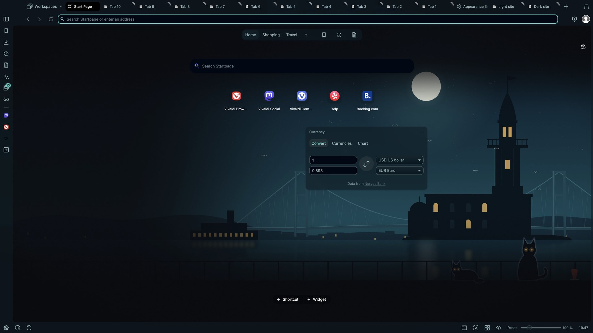

# Istanbul Nocturne: themes.vivaldi.net submission

Each field below matches the upload form, so you can copy it straight in. Tick the two declarations (image rights, terms) and click *Create theme*.

- **Theme name:** Istanbul Nocturne
- **Description:**
  > The Bosphorus at night, seen from the Asian shore. Maiden's Tower stands on its islet with the great suspension bridge behind it, a full moon rises over the water and a city ferry crosses with its windows aglow. Two street cats keep watch from the waterfront railing beside a tulip glass of tea, all in Bosphorus turquoise.
  >
  > The artwork flows behind the tab bar, address bar, panel and status bar. Background tabs stay softly dimmed and the focused tab stays bright, so you always know where you are. Original 4K vector artwork.
  >
  > Part of the VivaldiDark collection. Source: github.com/canartuc/VivaldiDark
- **Image source:** https://github.com/canartuc/VivaldiDark/tree/main/themes/istanbul-nocturne (original art, generated by the code in that folder)
- **Icon source:** https://github.com/canartuc/VivaldiDark/tree/main/icons (original outline icons)
- **Image rights:** true. The owner holds copyright on all the art and it contains no trademark logos. The tower and bridge are drawn as simple silhouettes with no logo.
- **Theme file:** `themes/istanbul-nocturne/Istanbul-Nocturne.zip`
- **Categories:** Dark · Art · Nature
- **Colors:** Blue · Green
