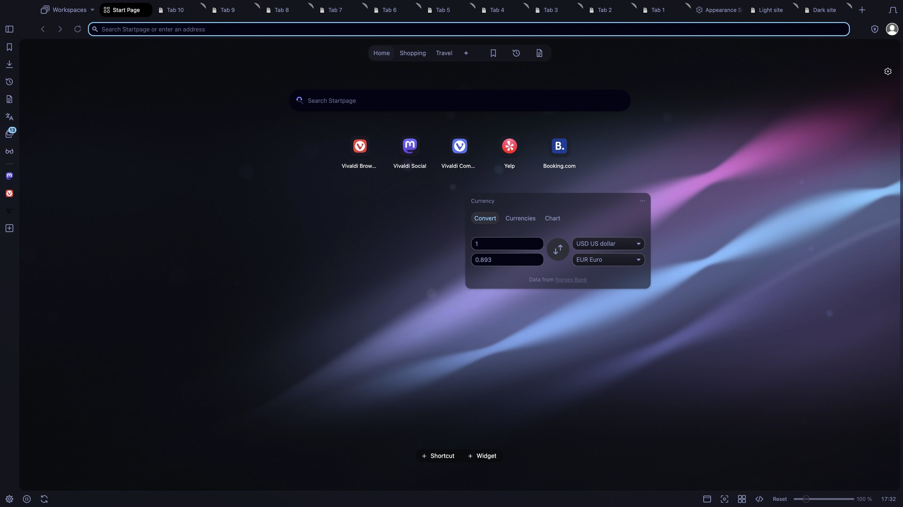

# Silk Nocturne: themes.vivaldi.net submission

Each field below matches the upload form, so you can copy it straight in. Tick the two declarations (image rights, terms) and click *Create theme*.

- **Theme name:** Silk Nocturne
- **Description:**
  > Calm, minimal and dark: ribbons of silk in Tokyo Night blues, violets and cyans sweep from corner to corner, leaving the middle quiet for your Speed Dials.
  >
  > The artwork flows behind the tab bar, address bar, panel and status bar. Background tabs stay softly dimmed and the focused tab stays bright, so you always know where you are. Original 4K vector artwork.
  >
  > Part of the VivaldiDark collection. Colours inspired by Tokyo Night by Enkia (MIT). Source: github.com/canartuc/VivaldiDark
- **Image source:** https://github.com/canartuc/VivaldiDark/tree/main/themes/silk-nocturne (original art, generated by the code in that folder)
- **Icon source:** https://github.com/canartuc/VivaldiDark/tree/main/icons (original outline icons)
- **Image rights:** true. The owner holds copyright on all the art and it contains no trademark logos.
- **Theme file:** `themes/silk-nocturne/Silk-Nocturne.zip`
- **Categories:** Abstract · Dark · Minimalist
- **Colors:** Blue · Purple
