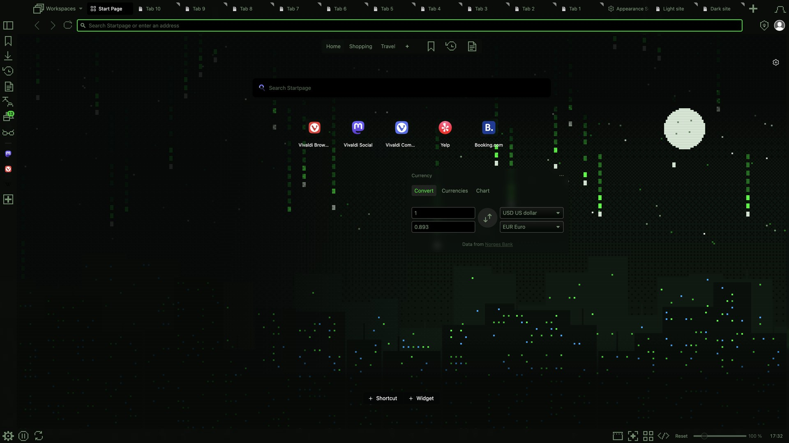

# Terminal City: themes.vivaldi.net submission

Each field below matches the upload form, so you can copy it straight in. Tick the two declarations (image rights, terms) and click *Create theme*.

- **Theme name:** Terminal City
- **Description:**
  > A pixel skyline at night under falling green code rain, with a pale pixel moon above the rooftops.
  >
  > The artwork flows behind the tab bar, address bar, panel and status bar. Background tabs stay softly dimmed and the focused tab stays bright, so you always know where you are. Original pixel art, drawn on a 480×270 grid and scaled 8× to 4K.
  >
  > Part of the VivaldiDark collection. Palette from canartuc.com. Source: github.com/canartuc/VivaldiDark
- **Image source:** https://github.com/canartuc/VivaldiDark/tree/main/themes/terminal-city (original art, generated by the code in that folder)
- **Icon source:** https://github.com/canartuc/VivaldiDark/tree/main/icons/pixel (original pixel icons on a 14×14 grid)
- **Image rights:** true. The owner holds copyright on all the art and it contains no trademark logos.
- **Theme file:** `themes/terminal-city/Terminal-City.zip`
- **Categories:** Dark · Technology · Art
- **Colors:** Green · Black
